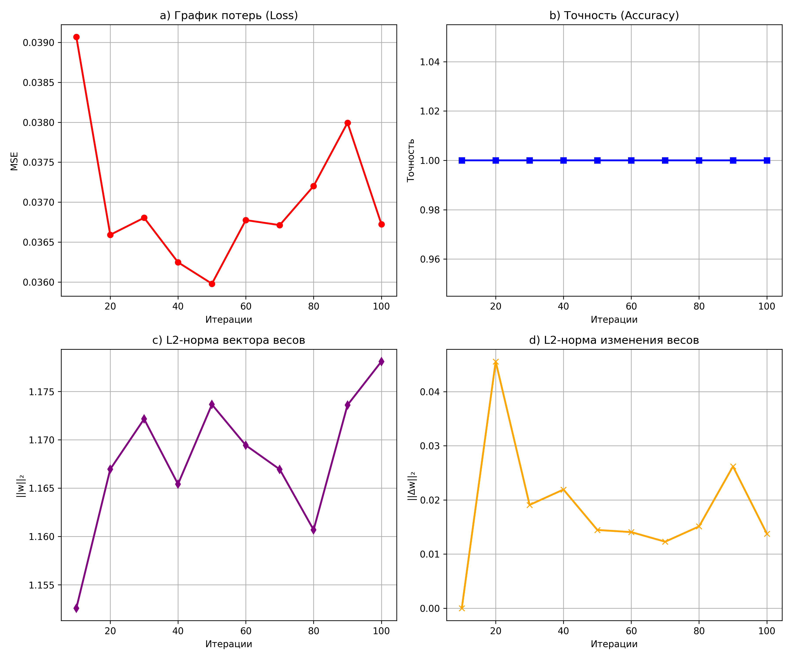

Исследование и классификация датасета Iris (Machine Learning)

Данный проект выполнен в рамках обучения в УлГТУ (направление "Искусственный интеллект").

Что реализовано в проекте:

    EDA (Разведочный анализ данных): Загрузка данных, проверка баланса классов, анализ распределения признаков (min/max) для каждого вида.

    Предобработка: Разделение выборки на train/test (80/20) и масштабирование признаков (StandardScaler).

    Baseline: Создание простой эвристической модели на основе правил (по длине лепестка) для сравнения с ML.

    Классификация (Decision Tree): Обучение дерева решений и подбор оптимальной гиперпараметра max_depth (от 3 до 10).

    Градиентный спуск (SGDRegressor): Исследование внутренней математики ML. Реализовано обучение с warm_start для отслеживания динамики изменения весов, L2-нормы градиента и функции потерь (MSE) на разных итерациях.

    Визуализация: Построение графиков Loss, Accuracy, L2-нормы весов и их изменений с помощью matplotlib.

